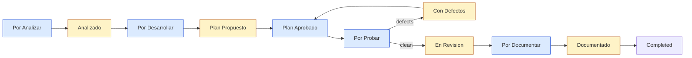

# SDLC pipeline: Symphony, BossDream and the role agents

[`WORKFLOW.sdlc.example.md`](../WORKFLOW.sdlc.example.md) runs the whole SDLC from one Wrike queue. Each Wrike status where an agent works routes the task to one role, and each role ends by moving the task to a status where a person reviews it.

Three pieces work together, each with its own job:

| Piece | Decides | Lives in |
|---|---|---|
| **Symphony** | *When* a role runs and *where*: polls Wrike, keeps one workspace per task, renders the prompt for the task's status, moves the status | this repository |
| **Role agents** | *What* each role produces and *how*: XAF/XPO conventions, branches, documents, checklists | `.claude/agents/*.md` in the target repository (from `artifacts/Agents/`) |
| **BossDream** | *Whether the work is done*: mode lock, quality pipeline and completion gates, enforced by hooks | `.claude/` and `bossdream.json`, `pipeline.json`, `completion.json` in the target repository |

## Wrike statuses

Create these statuses in the queue's Wrike workflow. Only the **agent** rows go in `active_states`. If a human gate were active, the next role would start before anyone reviewed the previous one.

| Status | Who | What happens | Moves to |
|---|---|---|---|
| Por Analizar | agent: analyst | Scope document, INVEST stories, technical analysis on `analisis/<id>-…` | Analizado |
| Analizado | person | Review with the stakeholder, fill the `PENDIENTE` fields, sign off | Por Desarrollar |
| Por Desarrollar | agent: developer (plan) | Task list in `plans/<id>/tasks.md` on `feature/<id>-…`, posted as a comment | Plan Propuesto |
| Plan Propuesto | person | Approve the task list, or comment changes | Plan Aprobado |
| Plan Aprobado | agent: developer (+ UI/UX checklist) | Implements and ticks the tasks; BossDream gates must pass | Por Probar |
| Por Probar | agent: tester | Test cases from the acceptance criteria, automated tests, defects as comments | Con Defectos or En Revision |
| Con Defectos | person | Triage the defects | Plan Aprobado (fix) or En Revision |
| En Revision | person | Open the PR in Azure DevOps, review and merge into `dev` | Por Documentar |
| Por Documentar | agent: documentador | End-user manual from what is in `dev`, on `manual/<id>-…` | Documentado |
| Documentado | person | Review the manual, add screenshots, export to PDF/Word | Completed |
| Requiere Informacion | person | Any agent stops here when it needs an answer; the question is in the comments | the status it came from |
| Completed, Cancelled | — | Terminal: Symphony removes the workspace | — |

The only place where one agent stage hands straight to another is Plan Aprobado → Por Probar. The tester checks the developer's work, so nothing needs a person in between.

## How each stage is enforced

The prompt for each stage contains a `/bossdream-mode <mode>` line. BossDream's `readiness` hook reads the prompt and writes `.claude/.work-mode` in the workspace. From then on, `plan-lock` enforces the mode for every edit:

| Stage | Role file | BossDream mode | Effect |
|---|---|---|---|
| Por Analizar | `analyst.md` | `plan` | Code edits are blocked; Markdown and diagrams are allowed |
| Por Desarrollar | `developer.md` | `plan` | Same: the agent can write the plan but no code |
| Plan Aprobado | `developer.md`, `uiux.md` | `implement` | Code edits allowed. The Stop hook runs the local pipeline and `tasks-complete`, and blocks until both pass |
| Por Probar | `tester.md` | `implement` | Same gates for the tests the agent adds |
| Por Documentar | `documentador.md` | `document` | Code edits are blocked |

The developer agent's rule "present the task list and wait for approval" becomes the Por Desarrollar → Plan Propuesto → Plan Aprobado round trip. BossDream's `tasks-complete` gate then makes sure every approved task is ticked before the session can finish.

## Overrides the prompt applies to the role files

The role files were written for interactive use. In every stage, the workflow prompt overrides them in these ways:

- **Questions:** wherever a role says to ask the user or a stakeholder, the agent posts the question as a comment and moves the task to *Requiere Informacion*. The analyst writes `PENDIENTE` for stakeholder-only fields (request number, Product Owner, business area) instead of stopping, and lists them in its comment.
- **Tracker:** defects and hand-offs go to Wrike comments, not Azure Boards or `.docx` files. The tester uses the fields of the RY-01AC01-R02 format, and a person produces the official document if one is needed.
- **Branches:** each branch name starts with the Wrike identifier (`feature/<id>-<slug>`) so a later stage can find it. The developer branches from the analysis branch, so the analysis travels with the code in the same PR.
- **Out of scope for the agents:** E2E (TestCafe), Postman suites and visual checks need a running app. Keep them with people or in CI.

## Setup in the target repository

1. Install BossDream in the repository the same way as in Symphony-Sandbox: `.claude/settings.json` with its hooks, `.claude/bossdream-hooks/`, `bossdream.json`, `pipeline.json` and `completion.json`. Set `testing.project` to the XAF test project. Machines that run Symphony need PowerShell 7 (`pwsh`); without it the hooks don't run, and SessionStart only prints a warning.
2. Copy `artifacts/Agents/*.md` to `.claude/agents/`. Fix the cross-references inside them (`Agents/developer.md` → `.claude/agents/developer.md`).
3. Add the BossDream session files to `.gitignore` (`.claude/.work-mode`, `.claude/.active-plan`, `.claude/.completion-state.json`, `.claude/.bossdream-dirty`), as the sandbox does.
4. Configure the DevExpress NuGet feed **once per machine**, in the user-level NuGet config, so the agent never sees the key and the workspace's `nuget.config` doesn't change.
5. Create the Wrike statuses above. Copy `WORKFLOW.sdlc.example.md` to `WORKFLOW.md`, set the clone URL, and run `symphony WORKFLOW.md`.

## Known limits

- **One model for every stage.** `claude.model` applies to every stage. BossDream's `models` (Opus for planning, Sonnet for code) can't be applied per status yet.
- **Gate cost.** The Stop hook runs the full local tier of `pipeline.json`, including Stryker if it's enabled. On Magnacero that can be slow, so start with mutation testing disabled or limited to changed files.
- **Unscoped task gate.** Without `.claude/.active-plan`, `tasks-complete` checks every `plans/**/tasks.md`. A plan from another task left unticked on the same branch blocks this one.
- **Architect.** The architect has no stage. Use it interactively when the analysis says a change crosses modules or hosts.
